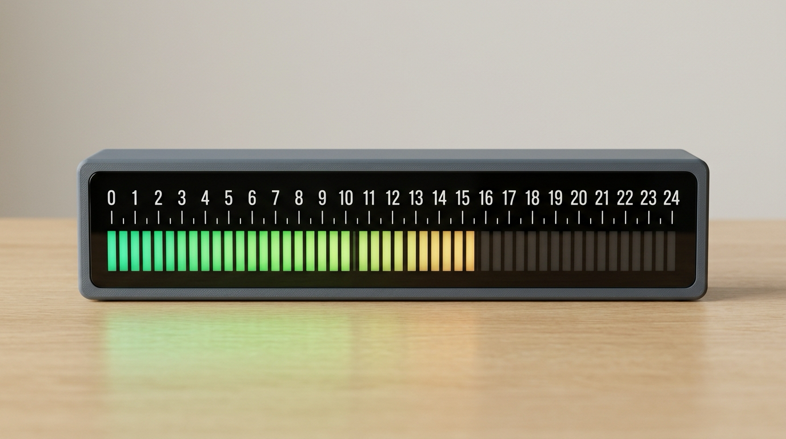
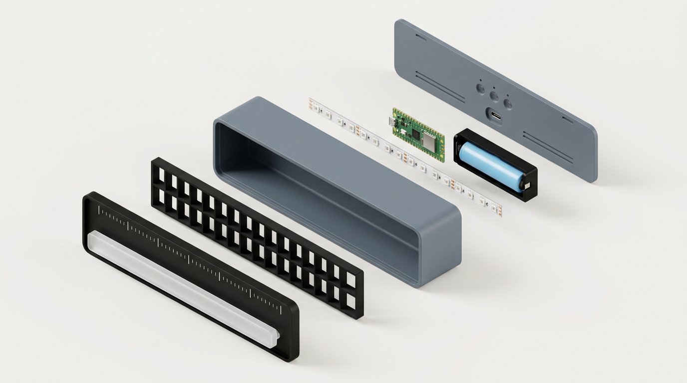

# Linear Clock — DIY Raspberry Pi Pico 2 W & Bambu Lab A1 PETG Edition



An open-source, battery-powered **Linear Clock** inspired by the [Daylight Machines Linear Clock](https://daylightmachines.com/products/linear-clock/) — refined into the simplest possible DIY build using off-the-shelf modules, a **single-piece PETG enclosure** designed for the **Bambu Lab A1**, **~7–10 days of unplugged battery life**, and programmable **MicroPython** color modes.

---

## Features

- **Visualizes the full 24-hour day at a glance** as a glowing horizontal RGB bar (each block fades in gradually as minutes pass).
- **Optimized for ~1 week (7–10 days) on battery** using `machine.lightsleep()`, 48 MHz underclocking, Wi-Fi off by default, a 24-LED Eco strip option, and an `IRLZ44N` MOSFET that cuts LED quiescent drain to `0 mA` during night sleep (`23:00–07:00`).
- **6 Programmable Display Modes**:
  1. `gradient` — Emerald → Lime → Golden Amber → Sunset Coral
  2. `fixed` — Any single custom RGB color
  3. `monochrome` — Calm warm daylight white
  4. `calm` — Ultra-low-power single glowing block + soft halo (~10+ days)
  5. `schedule` — Custom color-coded blocks for Sleep, Deep Work, Meetings, Evening
  6. `sun` — Golden daylight vs. deep indigo night with a bright current-time marker
- **Bambu Lab A1 Ready (PETG)**: `250 × 56 × 52 mm` single-piece body fits flat on the `256 × 256 mm` Textured PEI plate with **zero supports**.
- **Static GitHub Pages Showcase**: Interactive 48-LED simulator, renders, SVG wiring schematic, Botland BOM, and live-synced MicroPython config snippet.

---

## Repository Structure

```text
LinearClock/
├── index.html                      # Static GitHub Pages website (zero build step)
├── styles.css                      # Minimalist Scandinavian styling (Inter + IBM Plex Sans)
├── app.js                          # Interactive simulator, battery estimator & gallery
├── firmware/
│   └── main.py                     # Ultra-low-power MicroPython firmware for Pico W / Pico 2 W
├── cad/
│   ├── linear_clock_case.scad      # Parametric OpenSCAD enclosure source
│   └── stl/
│       ├── 01_main_body.stl        # 250×56×52 mm outer shell (Slate-Grey PETG)
│       ├── 02_led_baffle.stl       # 48-segment light-isolation grid (Matte Black PETG)
│       ├── 03_diffuser_faceplate.stl # 0.8 mm diffuser + scale (White/Black PETG)
│       └── 04_backplate.stl        # Rear panel: USB-C, power switch & 3 buttons
└── assets/
    ├── render-hero.png             # Studio product render
    ├── render-exploded.png         # Exploded assembly render
    ├── render-rear.png             # Open rear cavity & internals render
    ├── cad-assembly.png            # OpenSCAD assembly preview
    ├── cad-exploded.png            # OpenSCAD exploded preview
    └── cad-back.png                # OpenSCAD backplate preview
```

---

## Bill of Materials (Poland / Botland)

All compatible parts can be ordered together from **Botland (`botland.com.pl`)**:

| Component | Spec (1-Week Battery Build) | Qty | Est. PLN | Shop Link |
| :--- | :--- | :---: | :---: | :--- |
| **Raspberry Pi Pico 2 W** *(or Pico W)* | RP2350 microcontroller (~1.8 mA in `lightsleep`) | 1 | ~35 zł | [Botland](https://botland.com.pl/moduly-i-zestawy-do-raspberry-pi-pico-2/25727-raspberry-pi-pico-2-w-rp2350-arm-cortex-m33-cyw43439-wifibluetooth-5056561803975.html) |
| **WS2812B 144 LED/m Strip (5V)** | Cut to **24 LEDs (167 mm)** for ~8–10 days, or 48 LEDs | 1 m | ~55 zł | [Botland](https://botland.com.pl/paski-led-adresowane/5814-pasek-led-rgb-ws2812b-cyfrowy-adresowany-ip65-144-ledm-43wm-5v-1m-5904422374655.html) |
| **2× 18650 5V UPS (Waveshare 18306)** | Regulated 5V + charging *(or budget 1× 18650 Shield)* | 1 | ~35–95 zł | [2× UPS](https://botland.com.pl/raspberry-pi-hat-nakladki-zasilajace/19046-zasilacz-awaryjny-ups-nakladka-zasilajaca-do-raspberry-pi-5-v-waveshare-18306-5904422367039.html) / [1× Shield](https://botland.com.pl/arduino-shield-rozszerzenia/29327-battery-18650-shield-nakladka-power-bank-do-arduino-5904257821034.html) |
| **18650 Li-Ion 3400–3500 mAh** | Samsung INR18650-35E or protected XTAR 3500 mAh | 2 | ~44 zł | [Samsung](https://botland.com.pl/akumulatory-li-ion/15216-ogniwo-18650-li-ion-samsung-inr18650-35e-3400mah-5904422343071.html) / [XTAR](https://botland.com.pl/akumulatory-li-ion/10934-ogniwo-18650-li-ion-xtar-3500mah-6952918340690.html) |
| **IRLZ44N Logic-Level N-MOSFET** | 3.3V gate-compatible; cuts LED strip ground at night | 1 | ~4 zł | [Botland](https://botland.com.pl/szukaj?s=IRLZ44N) |
| **Tact Switch 6×6 mm** | Rear Mode/Wake, Brightness & Color/+15m buttons | 3 | ~3 zł | [Botland](https://botland.com.pl/79-tact-switch) |
| **Passives & Hardware** | 330 Ω + 10 kΩ resistors, 470 µF 16V cap, 22 AWG wire, 4× M3×8 screws | 1 set | ~10 zł | [Botland](https://botland.com.pl/szukaj?s=rezystor+330) |
| **PETG Filament (1.75 mm)** | Matte Slate-Grey, Matte Black (baffle), White (diffuser) (~145 g total) | ~145 g | ~15 zł | [Botland](https://botland.com.pl/849-filamenty-petg) |

**Estimated Total**: ~200–260 zł (excluding 3D printer).

---

## Hardware Wiring Plan



| Signal | From | To | Notes |
| :--- | :--- | :--- | :--- |
| **+5V Power** | Battery UPS `5V OUT` | LED Strip `+5V` & Pico `VBUS` (Pin 40) | Place `470 µF` capacitor across `+5V` & `GND` near strip. |
| **Ground + Night Cutoff** | Battery `GND` → `IRLZ44N` (Source → Drain) | LED Strip `GND` *(Pico Pin 38 `GND` wired directly)* | Connect Pico `GP1` (Pin 2) to MOSFET Gate + `10 kΩ` pull-down to `GND`. |
| **LED Data** | Pico `GP0` (Pin 1) | LED Strip `DIN` | Inline `330 Ω` resistor protects the first LED. |
| **Rear Buttons** | Pico `GP14`, `GP15`, `GP16` | 3× Tactile Buttons → `GND` | Uses internal `PULL_UP` + IRQ wake from `lightsleep()`. |

> **USB Safety Tip:** Always turn the battery switch **OFF** when plugging the Pico 2 W into your computer via USB (or wire Battery `+5V` into `VSYS` Pin 39 through a `1N5819` Schottky diode).

---

## 1-Week Battery Power Budget

With **2× 18650 (6800 mAh @ 3.6V ≈ 24.5 Wh → ~4160 mAh usable at 5V)**:

- **Daytime (16h/day, 24 LEDs @ 10% Eco PWM)**: `1.8 mA` (Pico `lightsleep`) + `20 mA` (WS2812B idle) + `~7–9 mA` (active LEDs) ≈ **~29 mA**
- **Nighttime (8h/day, `23:00–07:00`, MOSFET cutoff)**: `1.8 mA` (Pico `lightsleep`) + `0 mA` (LED strip disconnected) = **1.8 mA**
- **24-Hour Daily Average**: **~20 mA** → **~200+ hours (~8.3 days)** in Gradient/Schedule mode, or **~10+ days** in Calm mode.

---

## 3D Printing Guide (Bambu Lab A1 · PETG)

Import the 4 STLs from [`cad/stl/`](./cad/stl/) into Bambu Studio:

- **Filament**: PETG (Slate Grey for `01_main_body.stl` & `04_backplate.stl`, Matte Black for `02_led_baffle.stl`, Natural/White for `03_diffuser_faceplate.stl`)
- **Build Plate**: Textured PEI Plate @ **70 °C**
- **Nozzle**: 0.4 mm @ **255 °C**
- **Layer Height**: `0.20 mm` Standard (`0.16 mm` for diffuser)
- **Walls / Infill**: 3 wall loops · 15% Gyroid infill
- **Supports**: **None** (print `01_main_body.stl` face-down)
- **Estimated Print Time**: ~4h 10m total (~145 g PETG)

---

## Firmware Setup (MicroPython)

1. Hold **BOOTSEL** on the Raspberry Pi Pico 2 W and connect it via USB (`RPI-RP2` drive appears).
2. Copy the latest MicroPython `.uf2` from [micropython.org/download](https://micropython.org/download/) onto `RPI-RP2`.
3. Open [Thonny](https://thonny.org/), select **MicroPython (Raspberry Pi Pico)**, and open [`firmware/main.py`](./firmware/main.py).
4. Customize `NUM_LEDS` (`24` or `48`), `NIGHT_SLEEP_START`/`END`, or any RGB color tuple in `FIXED_COLORS`, `GRADIENT_STOPS`, or `SCHEDULE_BLOCKS`.
5. Save the file to the Pico as **`main.py`**, unplug USB, and flip the battery power switch ON.

---

## Hosting the Webpage on GitHub Pages

No build step or dependencies are required:

1. Push this repository to GitHub.
2. Open **Settings → Pages → Build and deployment**.
3. Set **Source** to **Deploy from a branch**, select `main` and `/ (root)`, and click **Save**.
